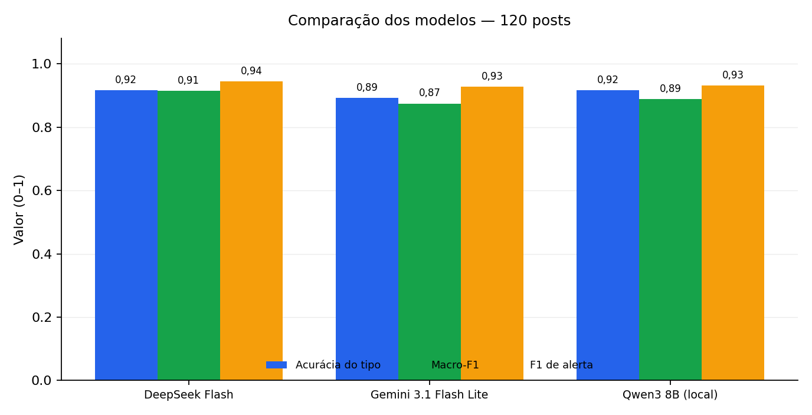

# Avaliação de LLMs para alertas de segurança em São João del-Rei

**Data:** 03/11/2026  
**Amostra:** 120 posts anotados manualmente  
**Modelos:** DeepSeek Flash, Gemini 3.1 Flash Lite, Qwen3 8B (local)  
**Prompt:** few-shot com 26 exemplos, temperatura 0 e saída JSON  
**Gabarito:** anotação manual cega, sem usar pré-rótulos do Gemini

---

## 1. Resumo executivo

Os três modelos foram avaliados nos mesmos 120 posts, com o mesmo prompt e o mesmo gabarito. A tarefa tem duas decisões: **qual é o tipo do evento** (`tipo_perigo`) e **se o item deve gerar alerta** (`relevante`).

| Modelo | Cobertura | Acurácia do tipo | Macro-F1 | Acurácia de alerta | Precisão de alerta | Recall de alerta | F1 de alerta |
|---|---:|---:|---:|---:|---:|---:|---:|
| **DeepSeek Flash** | 120/120 | 0,917 | 0,915 | 0,950 | 0,927 | 0,962 | 0,944 |
| **Gemini 3.1 Flash Lite** | 120/120 | 0,892 | 0,875 | 0,933 | 0,881 | 0,981 | 0,929 |
| **Qwen3 8B (local)** | 120/120 | 0,917 | 0,889 | 0,942 | 0,960 | 0,906 | 0,932 |

**Leitura rápida**

- **Melhor qualidade geral:** DeepSeek Flash, com macro-F1 0,915 e acurácia de alerta 0,950.
- **Melhor relação custo-benefício:** Qwen3 8B (local), rodando localmente e sem custo por requisição. Fica 2,55 pontos percentuais abaixo do melhor em macro-F1, com precisão de alerta 0,960 e recall 0,906.
- **Comportamento do Gemini:** recall de alerta 0,981 e precisão 0,881; ele alerta quase todos os casos relevantes, mas erra mais por excesso (falsos positivos).

A recomendação prática está na seção 8. Em resumo: **DeepSeek** se a prioridade for máxima qualidade; **Qwen3 local** se a prioridade for custo zero, privacidade e independência de API; **Gemini** como opção intermediária, com ajuste de limiar para reduzir falsos positivos.

## 2. Objetivo e pergunta de avaliação

O objetivo é escolher o modelo que transforma posts da página **SJDD Oficial** em alertas de segurança confiáveis para São João del-Rei e o Campo das Vertentes. A pergunta não é apenas “qual acerta mais a classe”, mas também:

1. Ele evita alertar o que não é perigo?
2. Ele deixa passar eventos que deveriam alertar?
3. Ele reconhece itens fora da área de cobertura?
4. O custo e a latência são compatíveis com a operação?
5. É possível rodar sem enviar dados para terceiros?

## 3. Base de avaliação

A amostra tem **120 posts únicos**, selecionados com seed fixa e estratificados para incluir classes raras, itens de baixa confiança do classificador antigo e posts fora do pool pré-classificado com termos de perigo. A anotação foi feita manualmente e às cegas, sem consultar os pré-rótulos do Gemini.

- **53 itens alertáveis** e 67 não alertáveis.
- **6 itens fora da área** de cobertura; alertar esses itens conta como falso positivo.
- **14 itens marcados para revisão** por ambiguidade, truncamento ou informação insuficiente.
- A classe `iluminacao_ruim` tem **suporte 0** e não entra no macro-F1; isso é reportado explicitamente.

A regra de relevância é: **`relevante = (tipo_perigo != "nenhum") e (fora_da_area == false)`**. A geografia não muda o tipo do evento; um incêndio em Belo Horizonte continua `incendio_fumaca`, mas recebe `fora_da_area=true` e `relevante=false`. Por isso a métrica binária é sobre `relevante`, e não sobre “o modelo citou algum perigo”.

| Classe | Itens no gabarito |
|---|---:|
| `assedio` | 2 |
| `iluminacao_ruim` | 0 |
| `perseguicao` | 3 |
| `local_suspeito` | 3 |
| `acidente_transito` | 4 |
| `assalto` | 6 |
| `furto` | 4 |
| `violencia_fisica` | 7 |
| `presenca_arma` | 5 |
| `incendio_fumaca` | 6 |
| `via_bloqueada` | 3 |
| `emergencia_medica` | 11 |
| `nenhum` | 66 |

## 4. Como a avaliação foi feita

Os três modelos receberam **exatamente o mesmo prompt**: 26 exemplos few-shot (2 por classe), regras de desempate, definição da área de cobertura e o schema de saída. O conteúdo dos exemplos foi truncado em 600 caracteres para viabilizar o modelo local; isso vale igualmente para os três, então a comparação é justa.

Cada resposta foi gravada em JSONL com texto bruto, JSON parseado, latência e erro. Respostas com JSON inválido ou fora do schema foram contadas separadamente. As métricas multiclasse usam `tipo_perigo`; as binárias usam `relevante`, nunca `tipo_perigo != nenhum`.

| Modelo | Como foi executado | Onde os dados passam |
|---|---|---|
| DeepSeek Flash | API local de sessões do OpenCode, uma sessão por item | Servidor do provedor |
| Gemini 3.1 Flash Lite | API Google Generative Language, `temperature=0`, JSON mode | Servidor do Google |
| Qwen3 8B | Ollama local, `/api/chat`, `format=json`, 100% GPU | Fica na máquina local |

## 5. Resultados

### 5.1 Métricas principais

| Modelo | Acurácia tipo | Macro-F1 | Acurácia alerta | Precisão alerta | Recall alerta | F1 alerta |
|---|---:|---:|---:|---:|---:|---:|
| DeepSeek Flash | 0,917 | 0,915 | 0,950 | 0,927 | 0,962 | 0,944 |
| Gemini 3.1 Flash Lite | 0,892 | 0,875 | 0,933 | 0,881 | 0,981 | 0,929 |
| Qwen3 8B (local) | 0,917 | 0,889 | 0,942 | 0,960 | 0,906 | 0,932 |

O **macro-F1** dá o mesmo peso a todas as classes com suporte, então é a métrica mais adequada para não deixar as classes raras invisíveis. A **acurácia de alerta** é a métrica operacional: acertar se o item vira ou não alerta.

| Modelo | Alertas emitidos | Acertos (TP) | Falsos positivos | Falsos negativos |
|---|---:|---:|---:|---:|
| DeepSeek Flash | 55 | 51 | 4 | 2 |
| Gemini 3.1 Flash Lite | 59 | 52 | 7 | 1 |
| Qwen3 8B (local) | 50 | 48 | 2 | 5 |

No gabarito há **53 itens alertáveis**. A tabela acima mostra o trade-off operacional: o Gemini alerta mais e por isso tem recall maior, mas também mais falsos positivos; o Qwen3 é mais conservador.



### 5.2 Intervalo de confiança (bootstrap 95%)

Com 120 itens, diferenças pequenas podem ser ruído. Os intervalos abaixo mostram a faixa plausível de cada métrica.

| Modelo | Acurácia tipo | Macro-F1 | Acurácia alerta |
|---|---|---|---|
| DeepSeek Flash | 0,867–0,958 | 0,839–0,965 | 0,908–0,983 |
| Gemini 3.1 Flash Lite | 0,833–0,942 | 0,776–0,935 | 0,883–0,975 |
| Qwen3 8B (local) | 0,867–0,958 | 0,798–0,947 | 0,900–0,983 |

### 5.3 F1 por classe

| Classe | Suporte | DeepSeek Flash | Gemini 3.1 Flash Lite | Qwen3 8B (local) |
|---|---:|---:|---:|---:|
| `assedio` | 2 | 1,000 | 1,000 | 1,000 |
| `iluminacao_ruim` | 0 | — | — | — |
| `perseguicao` | 3 | 1,000 | 1,000 | 1,000 |
| `local_suspeito` | 3 | 0,667 | 0,667 | 0,571 |
| `acidente_transito` | 4 | 1,000 | 0,667 | 1,000 |
| `assalto` | 6 | 1,000 | 1,000 | 0,909 |
| `furto` | 4 | 1,000 | 0,857 | 0,750 |
| `violencia_fisica` | 7 | 0,769 | 0,727 | 0,727 |
| `presenca_arma` | 5 | 0,909 | 0,909 | 0,909 |
| `incendio_fumaca` | 6 | 1,000 | 1,000 | 1,000 |
| `via_bloqueada` | 3 | 0,857 | 1,000 | 1,000 |
| `emergencia_medica` | 11 | 0,846 | 0,733 | 0,857 |
| `nenhum` | 66 | 0,929 | 0,936 | 0,948 |

Células “—” indicam classe sem suporte; nesse caso a métrica é indefinida, não é zero.

### 5.4 Comparação pareada

Como os três completaram a avaliação, a comparação pareada usa **120 itens comuns**. Ela evita que diferenças de cobertura distorçam o resultado.

| Modelo | N | Acurácia tipo | Macro-F1 | Acurácia alerta | F1 alerta |
|---|---:|---:|---:|---:|---:|
| DeepSeek Flash | 120 | 0,917 | 0,915 | 0,950 | 0,944 |
| Gemini 3.1 Flash Lite | 120 | 0,892 | 0,875 | 0,933 | 0,929 |
| Qwen3 8B (local) | 120 | 0,917 | 0,889 | 0,942 | 0,932 |

### 5.5 Área de cobertura

O gabarito tem 6 itens fora da área. O modelo deve manter o tipo do evento, marcar `fora_da_area=true` e **não** alertar. Alertar um item fora da área é falso positivo operacional.

| Modelo | Fora no gabarito | Detectados como fora | Itens fora alertados |
|---|---:|---:|---:|
| DeepSeek Flash | 6 | 4/6 | 0 |
| Gemini 3.1 Flash Lite | 6 | 6/6 | 0 |
| Qwen3 8B (local) | 6 | 5/6 | 0 |

Nenhum dos três modelos alertou um item fora da área. A diferença está em quanto eles percebem corretamente que o evento é fora da cobertura; isso importa para o produto não gerar alerta para outras regiões.

### 5.6 Latência

| Modelo | Média | Mediana | p95 | Máxima |
|---|---:|---:|---:|---:|
| DeepSeek Flash | 2,8 s | 2,1 s | 5,0 s | 14,7 s |
| Gemini 3.1 Flash Lite | 3,9 s | 3,9 s | 5,8 s | 12,5 s |
| Qwen3 8B (local) | 12,1 s | 13,1 s | 18,4 s | 21,3 s |

O Qwen3 roda 100% na GPU local (RX 6700 XT, ROCm) e tem custo marginal zero. A primeira chamada inclui o carregamento do modelo e é mais lenta; as demais ficam na casa de 11–15 s por item.

### 5.7 Endereço

Comparação textual normalizada, sem geocodificação. A coluna “fuzzy” aceita variações de escrita; “fuzzy entre ambos” considera só os itens em que o modelo também devolveu algum endereço.

| Modelo | Itens com endereço no gabarito | Fuzzy | Fuzzy entre ambos | Endereço previsto sem GT |
|---|---:|---:|---:|---:|
| DeepSeek Flash | 64 | 0,844 | 0,857 | 39 |
| Gemini 3.1 Flash Lite | 64 | 0,688 | 0,688 | 38 |
| Qwen3 8B (local) | 64 | 0,625 | 0,635 | 9 |

Esse é o ponto mais fraco dos três. DeepSeek e Gemini frequentemente completam cidade ou bairro mesmo quando o gabarito não tinha endereço explícito (39 e 38 casos); o Qwen3 faz isso bem menos (9 casos), mas também acerta menos o endereço quando ele existe (fuzzy 0,625). Para o produto, todo endereço deve ser tratado como **local provável**, não como local confirmado, ou passar por geocodificação/validação antes de aparecer no alerta.

## 6. Onde os modelos erram

### 6.1 Principais confusões

| Modelo | Confusão | Ocorrências |
|---|---|---:|
| DeepSeek Flash | `nenhum` → `emergencia_medica` | 3 |
| DeepSeek Flash | `violencia_fisica` → `nenhum` | 1 |
| DeepSeek Flash | `local_suspeito` → `nenhum` | 1 |
| Gemini 3.1 Flash Lite | `nenhum` → `emergencia_medica` | 4 |
| Gemini 3.1 Flash Lite | `nenhum` → `local_suspeito` | 2 |
| Gemini 3.1 Flash Lite | `acidente_transito` → `emergencia_medica` | 2 |
| Qwen3 8B (local) | `nenhum` → `local_suspeito` | 2 |
| Qwen3 8B (local) | `emergencia_medica` → `nenhum` | 2 |
| Qwen3 8B (local) | `violencia_fisica` → `presenca_arma` | 1 |

Padrão observado: boa parte dos erros está na fronteira entre **emergência médica**, **violência física**, **presença de arma** e **nenhum**. São casos em que o texto descreve uma ocorrência policial ou um atendimento sem deixar claro se ainda há risco atual para a população.

### 6.2 Exemplos de divergência

Itens em que pelo menos um modelo divergiu do gabarito. A coluna de cada modelo mostra o tipo previsto e se ele geraria alerta (S/N).

| ID | Título | Gabarito | DeepSeek Flash | Gemini 3.1 Flash Lite | Qwen3 8B (local) |
|---|---|---|---|---|---|
| sjd-031 | O 38° Batalhão da Polícia Militar divulgou uma nota oficial sobre a ocorrência registrad… | `violencia_fisica` (S) | `nenhum` (N) | `local_suspeito` (S) | `nenhum` (N) |
| sjd-073 | O corpo de um homem ainda não identificado foi encontrado na madrugada desta terça-feira… | `violencia_fisica` (S) | `emergencia_medica` (S) | `emergencia_medica` (S) | `emergencia_medica` (S) |
| sjd-088 | Na noite de sexta-feira, 2 de janeiro, a Polícia Militar foi acionada em um hospital no … | `nenhum` (N) | `local_suspeito` (S) | `local_suspeito` (S) | `local_suspeito` (S) |
| sjd-001 | A Força Integrada de Combate ao Crime Organizado de Minas Gerais, a Ficco de Uberlândia,… | `nenhum` (N) | `nenhum` (N) | `local_suspeito` (S) | `local_suspeito` (S) |
| sjd-033 | A Prefeitura Municipal de São João del-Rei decretou três dias de luto oficial após a mor… | `nenhum` (N) | `emergencia_medica` (S) | `emergencia_medica` (S) | `nenhum` (N) |
| sjd-071 | A Polícia Civil de Minas Gerais (PCMG) recuperou, nesta quinta-feira ( , o manto e a cor… | `furto` (S) | `furto` (S) | `nenhum` (N) | `nenhum` (N) |
| sjd-074 | Um lobo-guará foi encontrado morto às margens de uma rodovia de acesso a Resende Costa. | `nenhum` (N) | `emergencia_medica` (S) | `emergencia_medica` (S) | `nenhum` (N) |
| sjd-098 | A família de Jorge Moreira Gomes, de 78 anos, tem pedido a apuração das circunstâncias q… | `nenhum` (N) | `emergencia_medica` (S) | `emergencia_medica` (S) | `nenhum` (N) |
| sjd-002 | Um homem foi preso na tarde de sábado (31), em São João del-Rei, após uma abordagem da G… | `violencia_fisica` (S) | `violencia_fisica` (S) | `violencia_fisica` (S) | `presenca_arma` (S) |
| sjd-010 | Um grave acidente foi registrado na manhã deste domingo na BR-265, nas proximidades da C… | `acidente_transito` (S) | `acidente_transito` (S) | `emergencia_medica` (S) | `acidente_transito` (S) |
| sjd-015 | Um enxame de abelhas causou preocupação e tumulto na tarde desta quinta-feira (23) na Ru… | `emergencia_medica` (S) | `emergencia_medica` (S) | `emergencia_medica` (S) | `nenhum` (N) |
| sjd-018 | Um motociclista morreu após um grave acidente registrado na tarde desta sexta-feira (27)… | `acidente_transito` (S) | `acidente_transito` (S) | `emergencia_medica` (S) | `acidente_transito` (S) |

Esses exemplos são os mais úteis para a reunião: mostram que a discussão não é só “qual modelo tem o maior número”, mas **que tipo de erro** cada um produz.

## 7. Custo, privacidade e operação

| Modelo | Custo por item | Privacidade | Dependência externa |
|---|---|---|---|
| DeepSeek Flash | Pago; custo não reportado pela API de sessão | Dados enviados ao provedor | API e saldo |
| Gemini 3.1 Flash Lite | Plano gratuito com limite de 15 req/min | Dados enviados ao Google | API e cota |
| Qwen3 8B local | Zero custo marginal | Dados não saem da máquina | GPU local |

> O relatório automático mostra US$ 0,000000 para DeepSeek e Gemini porque a API usada não devolveu tokens/custo. Isso **não** significa que sejam gratuitos. Para o Qwen3 local, o custo marginal é realmente zero; existe o custo do hardware e da energia.

Do ponto de vista operacional, o Qwen3 local é o único que funciona sem internet, sem chave de API, sem cota e sem enviar o conteúdo dos posts para terceiros. Em compensação, exige uma máquina com GPU e ocupa cerca de 7,5 GB de VRAM.

## 8. Recomendação

**Se a prioridade for qualidade máxima: DeepSeek Flash.** Lidera o macro-F1 (0,915) e a acurácia de alerta (0,950).

**Se a prioridade for custo zero e privacidade: Qwen3 8B (local).** Fica 2,55 pontos percentuais abaixo do melhor em macro-F1, mas roda localmente, sem cota, sem chave e sem enviar dados para fora. Para um piloto ou uma operação com orçamento restrito, é a escolha mais sustentável.

**Gemini 3.1 Flash Lite** é viável como API gratuita, mas o recall muito alto (0,981) vem com precisão menor (0,881). Se for usado, vale aplicar uma etapa de confirmação ou um limiar de confiança para reduzir alertas em excesso.

**Trade-off operacional observado:** o DeepSeek emitiu 55 alertas (51 corretos, 4 falsos positivos, 2 falsos negativos); o Qwen3 emitiu 50 (48 corretos, 2 falsos positivos, 5 falsos negativos). O Qwen3 erra menos por excesso, mas deixa passar mais eventos. A escolha depende de qual erro é mais caro para a operação.

**Sugestão de arquitetura:** usar o modelo local como primeira triagem, barato e privado, e reservar o modelo pago para os casos de baixa confiança ou de classes raras. Isso combina custo baixo com a qualidade do melhor modelo.

## 9. Limitações

- **Amostra de 120 itens**, com classes raras tendo 2–7 exemplos; uma diferença de um item muda bastante o F1 dessas classes.
- **Um único anotador.** Não houve dupla anotação nem cálculo de concordância (kappa). O gabarito é uma referência, não uma verdade absoluta.
- **Few-shot compacto.** Os exemplos foram truncados em 600 caracteres para viabilizar o modelo local. O prompt completo pode mudar o resultado, principalmente nos itens truncados.
- **Endereço avaliado por texto**, sem geocodificação. O relatório não mede distância real nem se o alerta chegaria ao bairro certo.
- **Custo do DeepSeek e do Gemini não foi reportado** pela API usada; não trate US$ 0,000000 como custo real.
- **Modelos e cotas mudam.** O Gemini 3.8 Flash estava indisponível; foi usado o 3.1 Flash Lite. O big-pickle free parou por limite de uso e ficou fora da comparação principal.

## 10. Próximos passos

1. Revisar os 14 itens marcados para revisão e os casos de divergência da seção 6.2.
2. Ampliar a amostra para 300–500 posts e incluir dupla anotação em pelo menos 20%.
3. Testar o prompt completo (sem truncar os exemplos) no Qwen3 local e comparar com o compacto.
4. Medir o custo real do DeepSeek e do Gemini por 1.000 posts antes de decidir.
5. Validar o modelo escolhido em produção sombra, comparando alertas com a avaliação humana por 2–4 semanas.

## 11. Arquivos e reprodutibilidade

- `scripts/data/eval/annotation_blind.jsonl` — amostra cega de 120 posts.
- `scripts/data/eval/ground_truth.jsonl` — gabarito anotado manualmente.
- `scripts/data/eval/few_shot_examples_compact.jsonl` — 26 exemplos usados no prompt.
- `scripts/data/eval/runs/` — respostas brutas, metadados e resumos por modelo.
- `scripts/data/eval/reports/comparison_metrics.json` — métricas completas, sem respostas brutas, próprio para versionamento.
- `scripts/data/eval/reports/comparison.json` — versão local completa, com predições e respostas brutas; não versionada por conter conteúdo de terceiros.
- `scripts/data/eval/evaluate.py` — cálculo das métricas e bootstrap.
- `scripts/data/eval/make_report.py` — geração deste relatório.

Comandos principais:

```powershell
python scripts/data/eval/evaluate.py `
  scripts/data/eval/runs/deepseek_flash_compact.jsonl `
  scripts/data/eval/runs/gemini_3_1_flash_lite_compact.jsonl `
  scripts/data/eval/runs/ollama_qwen3_8b_compact.jsonl `
  --out-dir scripts/data/eval/reports --name comparison --bootstrap 1000

python scripts/data/eval/make_report.py
```

## Apêndice — big-pickle free

O `opencode/big-pickle` foi testado, mas o plano gratuito impõe limite por sessão (uma geração por sessão) e um limite global por período. A execução parou perto de 50 itens, com prompt completo, e por isso **não entra na comparação principal**. Para usá-lo seria necessário assinatura OpenCode Go ou nova janela de cota.
